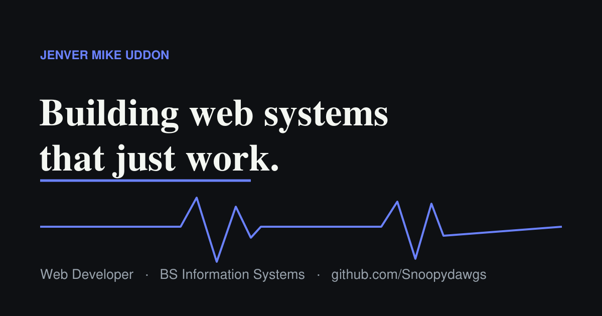

# Jenver Mike Uddon — Developer Portfolio


A fast, accessible developer portfolio with a clean monospace aesthetic — built from scratch with **TypeScript**, **TailwindCSS**, and **Vite**.

**🔗 Live:** https://snoopydawgs.github.io/



---

## About

I'm **Jenver Mike Uddon**, a web developer and BS Information Systems student from Cavite, Philippines. I build clean, database-driven web systems and I'm open for commissions, part-time, and gig work.

This portfolio is also a working sample of how I write code: typed, componentized, and accessible.

## Features

- ⌨️ **Command palette** (`⌘K` / `Ctrl+K`) for quick navigation and actions
- 🌗 **System / Light / Dark** appearance, with the choice remembered across visits
- 🎹 **Keyboard navigation** — jump between sections with keys `1`–`7`
- 💬 **Hover tooltips**, a contact form, and a copy-to-clipboard email (`⌘E`)
- 📱 **Fully responsive** — persistent left sidebar on desktop, stacked layout on mobile
- ♿ **Accessible** — semantic HTML, ARIA states, visible focus, and reduced-motion support
- ⚡ **Optimized build** — tree-shaken CSS (~5 KB gzipped) and a small typed JS bundle

## Tech stack

| Area | Tools |
| --- | --- |
| Language | TypeScript |
| Styling | TailwindCSS (CSS-variable theming) |
| Build | Vite |
| Hosting | GitHub Pages |

## Project structure

```
.
├── app/                  # Source (Vite + TypeScript + Tailwind)
│   ├── index.html        # Markup / entry
│   ├── src/
│   │   ├── main.ts       # All behaviour, typed
│   │   └── style.css     # Tailwind directives + component layer
│   ├── public/           # Static assets (résumé, OG image, robots, sitemap, 404)
│   ├── tailwind.config.js
│   ├── vite.config.ts
│   └── tsconfig.json
├── index.html            # Compiled output (served by GitHub Pages)
└── assets/               # Compiled, hashed CSS + JS
```

## Getting started

Requires [Node.js](https://nodejs.org/) 18+.

```bash
cd app
npm install     # install dependencies
npm run dev     # start the Vite dev server
npm run build   # type-check and build to app/dist
```

## Deployment

GitHub Pages serves the repository root as static files. To publish an update:

```bash
cd app && npm run build
cp -R dist/assets ../assets && cp dist/index.html ../index.html
cd .. && git add -A && git commit -m "Update site" && git push
```

## Contact

- **Email:** jenvermikeuddon@gmail.com
- **GitHub:** https://github.com/Snoopydawgs
- **LinkedIn:** https://www.linkedin.com/in/jenver-uddon-b26123420

---

<sub>© 2026 Jenver Mike Uddon. Code is available for reference; please don't redistribute the personal content.</sub>
